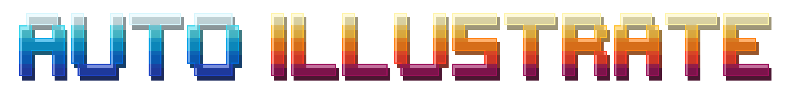
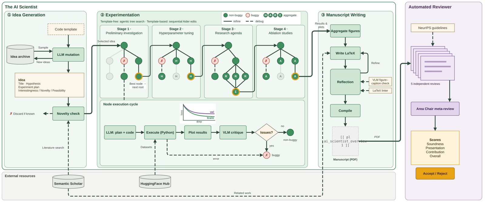
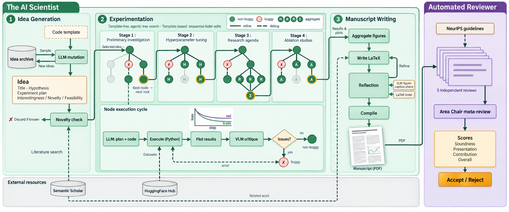
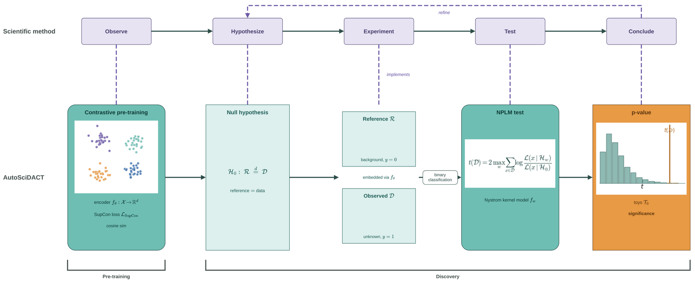
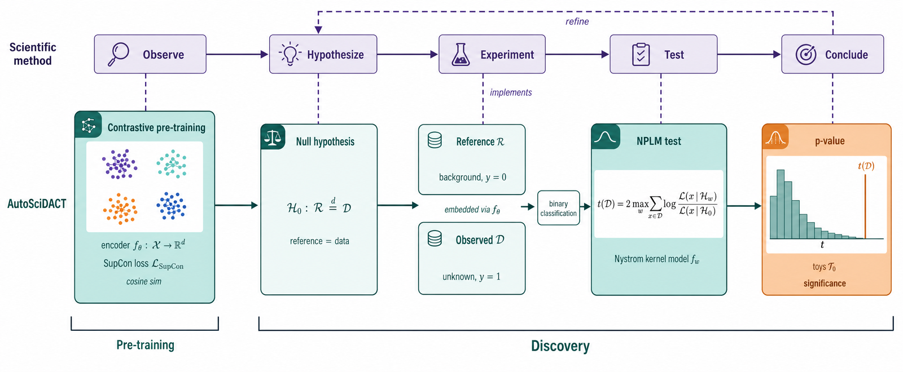
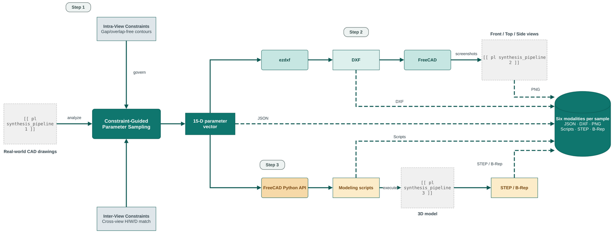
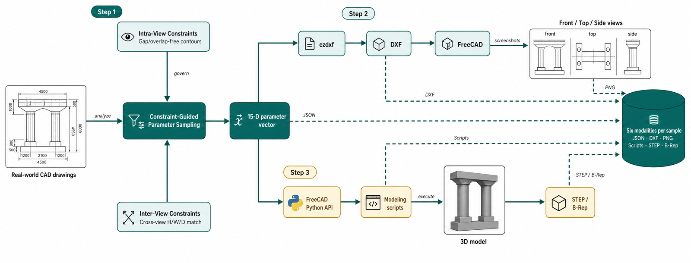
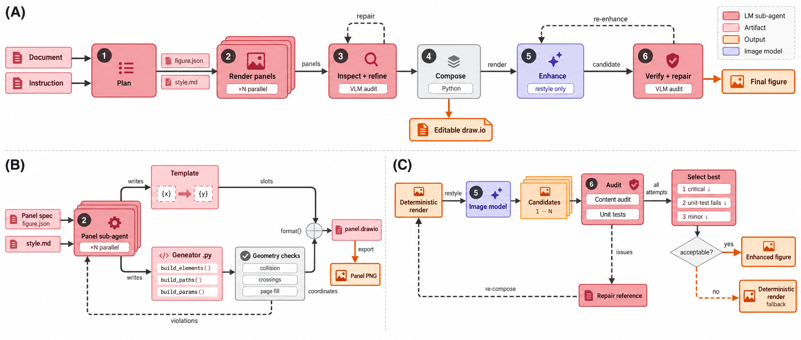

<p align="center">
  
</p>

<h1 align="center">Autoillustrate</h1>

<p align="center">
  <i>Generate publication-grade academic figures from a methodology brief.</i>
</p>


AutoIllustrate is a command-line tool that turns a methodology brief (a
paper section, a system description, or a verbal sketch) into a
publication-grade academic figure. It works in two steps:

1. It generates an editable, vectorised diagram as a `.drawio` file
   (essentially an XML file).
2. It then uses an image-generation model (`gpt-image-2.5-sunburst` by
   default) to produce a more visually appealing `.png`.

The deliverable is a real `.drawio` file you can keep editing in draw.io —
the generative model only touches the final restyle pass.

AutoIllustrate was used to generate the diagrams of
[The Agentic Scientist](https://github.com/SakanaAI/AI-Scientist-v3).

<table align="center">
  <tr>
    <th>Editable <code>full_figure.drawio</code>, exported as <code>full_figure.png</code></th>
    <th>Enhanced <code>full_figure_enhanced.png</code></th>
  </tr>
  <tr>
    <td></td>
    <td></td>
  </tr>
</table>
<p align="center"><i>Figure generated from the methods section of
<a href="https://www.nature.com/articles/s41586-026-10265-5">The AI Scientist</a>
paper (see the <a href="#quickstart">Quickstart</a>).</i></p>

## Install

```bash
npm install -g autoillustrate    # or: npx autoillustrate ...
```

Run `autoillustrate doctor` to check that the prerequisites below are
installed correctly.

> **Security note** — AutoIllustrate launches coding agents that can run
> arbitrary commands and inherit your environment, including your API keys.
> The source document you pass in steers those agents, so treat it like
> code: only run it on papers and files you trust, and preferably inside a
> container or VM rather than directly on your workstation. Run logs under
> `<workdir>/logs/` can echo document contents, so review them before
> sharing a run directory.

### Prerequisites

- **draw.io desktop CLI** on `PATH` as `drawio` (bundled with the
  [draw.io desktop app](https://github.com/jgraph/drawio-desktop/releases)).
- **Node ≥ 22**.
- **Python ≥ 3.10** — no manual setup is needed: on first run the CLI makes
  its own cached venv under `~/.cache/autoillustrate/`. Set
  `VENV_PY=/path/to/python` to use your own environment instead.
- **Headless CLI** (`@roberttlange/headless`) — all agent calls go through
  it. It is installed with AutoIllustrate. The default agent is Claude Code,
  so `claude` must also be on `PATH` unless you select a different `--agent`.
- **`OPENAI_API_KEY`** — required by default: the Phase 3 / Phase 6 vision
  audits use `gpt-6-astra`, and the Phase 5 restyle uses
  `gpt-image-2.5-sunburst` unless a different `--enhance-model` is selected.
- **`GEMINI_API_KEY`** — only if you select a Gemini backend:
  `--enhance-model nanobanana|nanobanana-pro`, or the
  `--audit-vlm gemini-3.1-pro` audit fallback.

Either export the keys in your shell or place them in a `.env` file in the
directory you run `autoillustrate` from. Headless Linux boxes, Chrome for
the export fallback, and other coding agents are covered in
[docs/install.md](docs/install.md).

## Quickstart

Point it at a paper (or a method section) and say what the figure should
depict. The example below uses
[`examples/ai_scientist_method.tex`](examples/ai_scientist_method.tex), the
methods section of the AI Scientist paper
([*Towards end-to-end automation of AI research*](https://www.nature.com/articles/s41586-026-10265-5)),
extracted from its [arXiv source](https://arxiv.org/abs/2606.15497):

```bash
autoillustrate examples/ai_scientist_method.tex \
    --prompt "Please make a diagram illustrating the method of our scientific research paper in a single panel. We intend to use it as front-page diagram in our research paper."
```

> **Note** — the prompt pins the layout to one panel. Leave that out and the
> tool decides for itself: a single panel, which often gives the figure a
> better flow, or up to three independent panels, which are generated in
> parallel and therefore faster.

That is a default `medium` run (~15 min). For a fast draft add
`--mode light` (~10 min); for a camera-ready figure with every audit loop
on, add `--mode full` (~30 min).

Add `--output <path>` to copy the final PNG (the enhanced figure when
available, otherwise the deterministic export) to a path of your choice.

### What you get

Each run creates a fresh `runs/<YYYY-MM-DD-HHMMSS>/` workdir and writes
three files to `<workdir>/figures/`:

- `full_figure.drawio` — the editable draw.io source.
- `full_figure.png` — the deterministic export rendered from the editable
  file (no model involved).
- `full_figure_enhanced.png` — the restyled figure.

<table align="center">
  <tr>
    <th>Editable <code>full_figure.drawio</code>, exported as <code>full_figure.png</code></th>
    <th>Enhanced <code>full_figure_enhanced.png</code></th>
  </tr>
  <tr>
    <td></td>
    <td></td>
  </tr>
</table>

Most `.drawio` components — boxes, arrows, formulas, labels — are
editable in [diagrams.net](https://app.diagrams.net) or the draw.io desktop
app. Two kinds of element are not directly editable:

- **Matplotlib subplots.** Visuals that are hard to draw in draw.io but easy
  in matplotlib (curves, histograms, heatmaps, …) are generated by a small
  Python script and embedded as images into the `.drawio` file. This applies
  to the plots on the left and right of the diagram above.
- **Placeholder boxes.** Visuals that neither tool can produce well (photos,
  hand-sketched scenes, 3D renders) are left as gray dashed placeholder
  boxes in the deterministic figure. These placeholders are filled by the
  image generation model in later stages, as shown below:

<table align="center">
  <tr>
    <th>Editable <code>full_figure.drawio</code>, exported as <code>full_figure.png</code></th>
    <th>Enhanced <code>full_figure_enhanced.png</code></th>
  </tr>
  <tr>
    <td></td>
    <td></td>
  </tr>
</table>

## More examples

### 1. Edit the figure by hand before it is enhanced

Run with `-i` / `--interactive`. After Phase 4 the run opens
`full_figure.drawio` in the diagrams.net editor in your browser (served from
`127.0.0.1`) and pauses. After making your changes, press Enter to
re-export the PNG and continue to the enhance phase. On a remote machine,
use `--editor-port <n>` and `ssh -L <n>:127.0.0.1:<n>`.

```bash
autoillustrate examples/ai_scientist_method.tex \
    --prompt "Please make a diagram illustrating the method of our scientific research paper in a single panel. We intend to use it as front-page diagram in our research paper." \
    --interactive
```

### 2. Suggest a style that matches the paper

Use the prompt to keep the figure coherent with the rest of the paper — for
instance, pass the caption verbatim so panel letters and per-panel captions
match, and pin the colour palette:

```bash
autoillustrate examples/ai_scientist_method.tex --prompt "$(cat <<'PROMPT'
Caption (verbatim, use for panel letters A/B/C and per-panel captions):
\caption{\textbf{The AI Scientist.} \textbf{(A)} Idea generation: research
proposals are refined against a literature search to ensure novelty.
\textbf{(B)} Experimentation: an experiment progress manager drives a
parallelised agentic tree search through four stages; each node generates
code, executes it, plots the results and has the plots critiqued by a VLM.
\textbf{(C)} Manuscript generation, followed by the AI Reviewer, which
ensembles five independent reviews into a meta-review.}

Respect the color scheme of the rest of the paper:
- Agent phases/nodes -> #ea9999
- Artifacts / components -> #f4cccc
- Outputs -> #fce5cd (use #f9cb9c to vary when there are several outputs)
- Others / less important stuff -> #f3f3f3
PROMPT
)"
```

### 3. Resume an earlier run from the compose step (Phase 4)

```bash
autoillustrate --workdir runs/2026-05-20-101010 --resume-from compose
```

### 4. Generate a figure from a project directory

The source can be a directory. Phase 1 walks it and reads every relevant
`.tex` / `.md` / `.py` / `.txt` file. Use the prompt to scope it to one
section or subsystem:

```bash
autoillustrate ./sources_bundle/ \
    --prompt "Please make a diagram illustrating the code architecture."
```

## How it works

<p align="center">
  
<i><b>The AutoIllustrate pipeline (diagram generated by AutoIllustrate).</b>
(A) Six phases turn a document and an instruction into an editable draw.io
figure. (B) In Phase 2, panels combine automatically generated templates with
coordinates determined by LLM-generated Python code. (C) In Phases 5 and 6,
the enhanced diagram with the best audit results is selected.</i>
</p>

Six phases run in sequence: **Plan → Render panels → Inspect → Compose →
Enhance → Verify**. LM sub-agents decide content, deterministic Python owns
geometry, and the generative image model only restyles. Phases 3 and 6 are
audit-and-repair loops that are off by default and enabled by `--mode full`.
See [docs/pipeline.md](docs/pipeline.md) for the details.

## Documentation

- [Installation](docs/install.md) — prerequisites in depth, headless Linux,
  the Chrome export fallback, other coding agents.
- [CLI reference](docs/cli.md) — every flag and subcommand, environment
  variables, export reliability.
- [Running and resuming](docs/running.md) — what the terminal output looks
  like, exit codes, interactive editing, resuming runs.
- [How it works](docs/pipeline.md) — the six phases, the `--mode` presets,
  what is editable, and the run directory layout.

## Citation

If you use AutoIllustrate in your research, please cite our paper,
[*The Agentic Scientist: Orchestrating Coding Agents for Automated Scientific (Co-)Discovery*](https://arxiv.org/abs/2610.18933):

```bibtex
@article{agentic_scientist,
  title   = {The Agentic Scientist: Orchestrating Coding Agents for Automated Scientific (Co-)Discovery},
  author  = {Lange, Robert Tjarko and Grillotti, Luca and Yamada, Yutaro and Charakorn, Rujikorn and Ha, David},
  journal = {arXiv preprint arXiv:2610.18933},
  year    = {2026}
}
```
